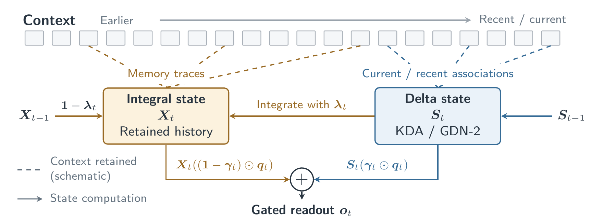
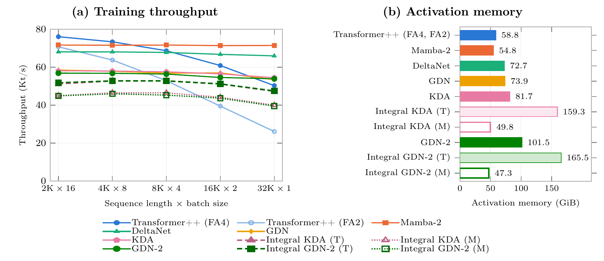

# Integral DeltaNet: Improved Linear Attention with Adaptive Memory Integration

Official PyTorch implementation of **Integral DeltaNet: Improved Linear Attention
with Adaptive Memory Integration**.

[Junsoo Oh](https://junsoo424.github.io/), [Jihun Yun](https://abcdxyzpqrst.github.io/),
[Junhyuck Kim](https://jhyuckkim.github.io/), [Hanbaek Lyu](https://www.hanbaeklyu.com/)

## 💡 Overview

Linear attention compresses the past into a fixed-size state, which causes
*memory collisions*. Delta-rule updates and gating reduce them, but they can
also discard information that a later query still needs.

Integral DeltaNet uses two states operating at different timescales: a fast
**delta state** $S_t$, updated using an expressive linear-attention rule such as
Kimi Delta Attention (KDA) or Gated DeltaNet-2 (GDN-2), and a slow **integral
state** $X_t$, which maintains a channel-wise weighted history of past delta
states. The model adaptively combines the two states at readout:

$$X_t = S_t\,\mathrm{Diag}(\lambda_t) + X_{t-1}\,\mathrm{Diag}(1-\lambda_t), \qquad
  o_t = S_t(\gamma_t \odot q_t) + X_t\big((1-\gamma_t) \odot q_t\big)$$

Here $o_t$ is the layer output for the query $q_t$. The integration rate
$\lambda_t \in [0,1]^{d_k}$ and the readout gate $\gamma_t \in [0,1]^{d_k}$ are
per-channel gates computed from the input. Training uses a chunkwise parallel
form of the two-state recurrence.

<p align="center">
  
</p>

- **Models.** Applied to KDA and GDN-2, this gives Integral KDA and Integral GDN-2.
- **Kernel modes.** `throughput-first` (default) and `memory-first` compute
  the same function. They trade training speed for activation memory.
- **GPUs.** Launch tables are tuned for A6000, GH200 and B300. Other GPUs
  autotune and get the same results.

## 🗂️ Configs and Checkpoints

| Model | 340M (15B tokens) | 1.3B (100B tokens) |
|---|---|---|
| KDA | `kda_340m.yaml` | `kda_1.3b.yaml` |
| Integral KDA | `integral_kda_340m.yaml` | `integral_kda_1.3b.yaml` |
| GDN-2 | `gdn2_340m.yaml` | `gdn2_1.3b.yaml` |
| Integral GDN-2 | `integral_gdn2_340m.yaml` | `integral_gdn2_1.3b.yaml` |

Model configs are in `configs/models/`, and the matching training recipes are
`configs/training/340m.yaml` and `configs/training/1.3b.yaml`. All models are
trained from scratch on FineWeb-Edu with the Llama 2 tokenizer and 4K
sequences. Each Integral model matches its backbone in non-embedding
parameters (340M or 1.3B).

All eight models are on [🤗 Hugging Face](https://huggingface.co/jsjs424/Integral-DeltaNet):

```python
import torch
from huggingface_hub import hf_hub_download
from integral_deltanet.model import CausalLM

ckpt = torch.load(hf_hub_download("jsjs424/Integral-DeltaNet", "integral-kda-1.3b.pt"), weights_only=True)
model = CausalLM(ckpt["model_config"]); model.load_state_dict(ckpt["model"])
```

## ⚙️ Installation

Requirements: Python >= 3.10, a CUDA build of PyTorch >= 2.7, and Triton.

```sh
git clone https://github.com/junsoo424/Integral-DeltaNet.git && cd Integral-DeltaNet
pip install torch --index-url https://download.pytorch.org/whl/cu128
pip install -r requirements.txt
pip install --no-build-isolation causal-conv1d   # optional, faster short convolutions
source env.sh                                    # sets $PY and the data / checkpoint directories
```

## 🚀 Quick start

```python
>>> import torch, yaml
>>> from integral_deltanet.model import CausalLM
>>> config = yaml.safe_load(open("configs/models/integral_kda_1.3b.yaml"))
>>> model = CausalLM(config).cuda().to(torch.bfloat16)
>>> model.num_parameters()
1450317600
>>> input_ids = torch.randint(0, config["vocab_size"], (1, 4096), device="cuda")
>>> loss = model(input_ids, labels=input_ids)
>>> loss.backward()
>>> model(input_ids).shape
torch.Size([1, 4096, 32000])
```

Pick the kernel mode with `INTEGRAL_KERNEL_MODE=throughput-first|memory-first`.

## 🔥 Training

```sh
$PY -m torch.distributed.run --standalone --nproc_per_node=8 train.py \
    --model-config configs/models/integral_kda_1.3b.yaml \
    --training-config configs/training/1.3b.yaml \
    --output-dir "$INTEGRAL_RUNS/integral-kda-1.3b" --resume auto
```

Recipe (`configs/training/`), shared by both scales:

- **Data.** FineWeb-Edu, Llama 2 tokenizer, 4K sequences, `<s>` before every document.
- **Optimizer.** AdamW (β = 0.9, 0.95; ε = 1e-8), weight decay 0.1, gradient clipping 1.0.
- **Schedule.** Linear warmup, then cosine decay from 4e-4 to 4e-5.
- **Batch.** 0.5M tokens per step on 8 GPUs, bf16 autocast.

| | 340M | 1.3B |
|---|---|---|
| Tokens / steps | 15B / 28,610 | 100B / 190,735 |
| Warmup | 0.5B tokens (954 steps) | 1B tokens (1,907 steps) |
| Training config | `340m.yaml` | `1.3b.yaml` |

For 340M, pair a `_340m` model config with `configs/training/340m.yaml`.
`--resume auto` continues from the newest checkpoint, so a preempted job can be
requeued.

## 📊 Results

1.3B models trained on 100B tokens of FineWeb-Edu. Bold marks the better model
of each backbone/Integral pair, and \* the best recurrent model.

### Language Modeling and Commonsense Reasoning

| Model | Wiki ppl ↓ | LMB ppl ↓ | LMB acc ↑ | Avg. acc ↑ |
|---|---|---|---|---|
| Transformer++ | 15.90 | 11.04 | 49.4 | 54.7 |
| Mamba-2 | 16.55 | 12.22 | 45.6 | 54.1 |
| DeltaNet | 15.73 | 11.51 | 47.3 | 54.3 |
| GDN | 16.08 | 10.98 | 48.5 | 54.7 |
| KDA | 15.33 | 9.63 | 50.4 | 54.6 |
| Integral KDA | **15.00**\* | **9.16**\* | **52.7**\* | **56.1**\* |
| GDN-2 | 16.34 | 10.56 | 49.3 | 54.2 |
| Integral GDN-2 | **15.92** | **10.31** | **50.6** | **54.6** |

### Needle-in-a-Haystack (NIAH)

| Model | S-NIAH-2 @4K | S-NIAH-3 @4K | MK-NIAH-1 @2K | MK-NIAH-1 @4K |
|---|---|---|---|---|
| Transformer++ | 86.2 | 69.8 | 94.4 | 77.0 |
| Mamba-2 | 65.8 | 13.2 | 21.2 | 18.4 |
| DeltaNet | 80.6 | 21.0 | 33.4 | 30.4 |
| GDN | 89.8 | 20.0 | 39.0 | 25.0 |
| KDA | 70.0 | 24.8 | 37.0 | 20.8 |
| Integral KDA | **99.6**\* | **41.6**\* | **50.4** | **35.6** |
| GDN-2 | **74.2** | 30.0 | 32.8 | 23.8 |
| Integral GDN-2 | 65.2 | **34.6** | **67.2**\* | **39.8**\* |

### Training Throughput and Memory (T: throughput-first, M: memory-first)

<p align="center">
  
</p>

### Decoding Memory (GiB) and Per-token Latency (ms)

| Model | Memory @4K | Memory @16K | Memory @64K | Latency @4K | Latency @16K | Latency @64K |
|---|---|---|---|---|---|---|
| Transformer++ | 7.77 | 22.95 | 83.70 | 5.18 | 12.74 | 42.59 |
| Mamba-2 | 2.85 | 2.85 | 2.85 | 2.15 | 2.15 | 2.15 |
| DeltaNet | 2.87 | 2.87 | 2.87 | 2.61 | 2.60 | 2.60 |
| GDN | 2.94 | 2.94 | 2.94 | 2.50 | 2.51 | 2.50 |
| KDA | 2.85 | 2.85 | 2.85 | 3.34 | 3.34 | 3.34 |
| Integral&nbsp;KDA | 2.99 | 2.99 | 2.99 | 4.63 | 4.63 | 4.63 |
| GDN-2 | 2.85 | 2.85 | 2.85 | 3.19 | 3.19 | 3.19 |
| Integral&nbsp;GDN&#8209;2 | 2.99 | 2.99 | 2.99 | 4.79 | 4.79 | 4.79 |

## 📝 Citation

```bibtex
@article{oh2026integral,
  title   = {Integral DeltaNet: Improved Linear Attention with Adaptive Memory Integration},
  author  = {Oh, Junsoo and Yun, Jihun and Kim, Junhyuck and Lyu, Hanbaek},
  journal = {arXiv preprint},
  year    = {2026}
}
```
